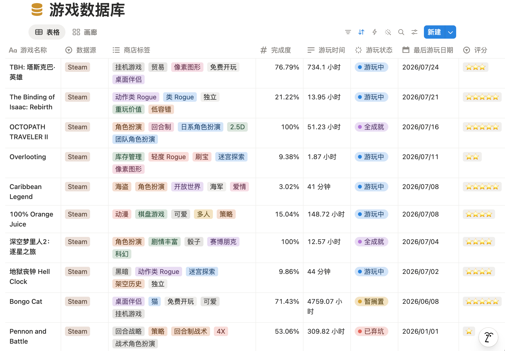
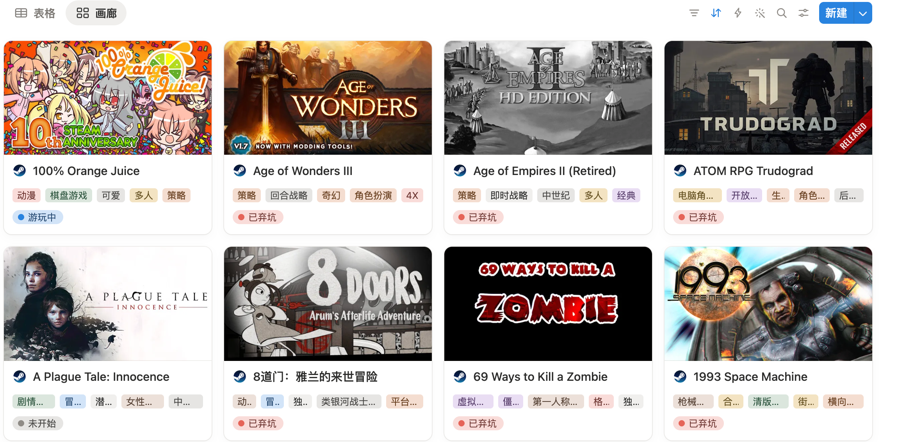
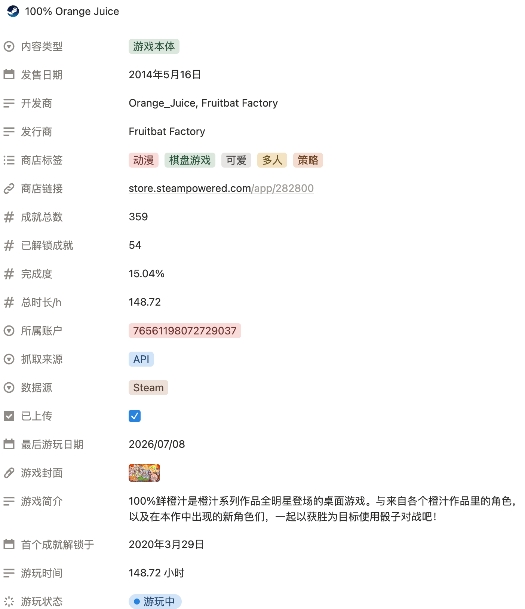

<p align="center">
  
</p>

# SteamShelf

把你的 Steam 游戏库同步到 Notion。  Steam to Notion Game Library Sync
SteamShelf 会定时读取 Steam 游戏、游玩时间、成就、商店信息和封面，并同步到一个可筛选、可评分、可写评价的 Notion 游戏库。

## 功能

- 同步 Steam 游戏名、AppID、游玩时间、最后游玩日期和成就进度。
- 自动写入商店链接、封面、开发商、发行商、发售日期、商店标签和游戏简介。
- 自动创建 Notion 缺失字段。
- 已存在的游戏会更新，不存在的游戏会新增。
- 支持多个 Steam 账号写入同一个 Notion 数据库。
- 支持 GitHub Actions 每天自动同步，也支持本地手动运行。
- 保留你的手工内容：`评分`、页面正文里的评价、备注等不会被覆盖。

## 预览






## 快速开始

1. 创建一个 Notion 数据库。
2. 把数据库分享给你的 Notion integration。
3. 准备 Steam API Key、Steam 用户 ID、Notion API Key 和 Notion Database ID。
4. 在本地 `.env` 或 GitHub Secrets 中配置这些值。
5. 运行 `python main.py --debug`，或启用 GitHub Actions 自动同步。

## Notion 字段

SteamShelf 会在运行时自动创建缺失的同步字段。你只需要先有一个 Notion 数据库，且数据库里存在一个 title 类型字段；脚本会把它当作 `游戏名称` 使用。

| 字段 | 类型 | 说明 |
| --- | --- | --- |
| `游戏名称` | title | 使用数据库已有的 title 字段 |
| `游戏封面` | files | Steam 封面图 |
| `游戏ID` | number | Steam AppID，用于稳定匹配 |
| `商店链接` | url | Steam 商店页面 |
| `游玩时间` | text | 适合阅读的时长，例如 `2.5 小时` |
| `总时长/h` | number | 小时数，适合排序和统计 |
| `完成度` | number | 建议在 Notion 设置成 percent；`0.25` 表示 25% |
| `成就总数` | number | Steam 成就总数 |
| `已解锁成就` | number | 已解锁成就数 |
| `首个成就解锁于` | date | 第一次解锁成就的日期 |
| `最后游玩日期` | date | Steam 记录的最后游玩日期 |
| `游玩状态` | status | 自动粗判：未开始、游玩中、暂搁置、已弃坑、全成就 |
| `开发商` | text | 来自 Steam 商店 |
| `发行商` | text | 来自 Steam 商店 |
| `发售日期` | date | 来自 Steam 商店 |
| `商店标签` | multi-select | 默认抓取前 5 个标签 |
| `内容类型` | select | 游戏本体、DLC、试玩版、原声音轨、其它 |
| `数据源` | select | 固定写入 `Steam`，方便未来混合管理其它平台 |
| `抓取来源` | select | `API` / `网页` / `两者都有` |
| `所属账户` | select | 多账号时用于区分账号 |
| `游戏简介` | text | 优先抓简体中文商店页简介 |
| `评分` | number | 手工填写，建议 1-5 |
| `已上传` | checkbox | 同步成功标记 |

SteamShelf 只更新页面属性、封面和图标，不会改页面正文。你可以把自己的评价写在 Notion 页面正文里，也可以继续添加 `备注`、`个人状态` 等自定义字段。

### 游玩状态规则

默认规则：

- 30 天内玩过：`游玩中`
- 31-180 天没玩：`暂搁置`
- 超过 180 天没玩：`已弃坑`
- 没有游玩时长且没有成就进度：`未开始`
- 成就全解锁：`全成就`

`已通关` 太依赖游戏本身，Steam 成就百分比不一定能代表通关，所以脚本不会再自动写入这个状态。

阈值可以通过 `ABANDONED_DAYS` 调整，默认是 `180`。

## 本地运行

```bash
python -m venv .venv
source .venv/bin/activate
pip install -r requirements.txt
```

在项目根目录创建 `.env`：

```bash
STEAM_API_KEY=你的 Steam API Key
STEAM_USER_ID=你的 SteamID64、自定义短链接名或 Steam 个人主页 URL
NOTION_API_KEY=secret_xxx
NOTION_DATABASE_ID=你的 Notion database id
NOTION_SCHEMA=cn
```

运行同步：

```bash
python main.py --debug
```

只抓数据、不写 Notion：

```bash
python main.py --dry-run --export-csv steam_games.csv
```

导出 Excel：

```bash
python main.py --dry-run --export-xlsx "Steam Data.xlsx"
```

## GitHub Actions

工作流文件位于：

```text
.github/workflows/steam-to-notion.yml
```

默认每天 `12:00 UTC` 自动运行，也可以在 GitHub 的 Actions 页面手动触发。

Actions 每次运行都会先读取 Notion 已有页面，复用商店元数据和成就数据，减少重复请求：

- 成就只在新增游戏、缓存缺失、游玩时长或最后游玩日期变化、最近两天玩过时查询。其它游戏按 AppID 分散到 30 天内轮换刷新，以补充离线同步或成就规则变化。
- 已有完整商店元数据的游戏不会再请求 Steam 商店。已有页面缺少封面、商店标签、开发商/发行商、简介或内容类型时，按 AppID 分散到 7 天内重试补齐；新游戏会立即查询。
- 每天仍会重算游玩状态，并比较属性、封面和图标；只有实际变化才写入 Notion。缓存命中且没有发起请求的记录不会额外等待。

Steam 成就接口临时失败时会保留已有成就，不会清零；后续按上述触发规则重试。没有可用成就缓存的游戏会在下次运行再次查询。

可以手动运行 workflow，勾选 `refresh_store_metadata` 强制刷新商店元数据，或勾选 `refresh_achievements` 强制刷新全库成就。

每次运行默认最多 30 分钟，防止异常请求持续消耗 Actions 时长。首次导入大游戏库或手动全量刷新时，可以勾选 `extended_timeout`，把本次上限提高到 120 分钟。达到上限会取消运行；已写入的数据会保留，下次运行会继续比较并同步。

需要配置这些 Secrets：

| Secret | 说明 |
| --- | --- |
| `STEAM_API_KEY` | Steam Web API Key |
| `STEAM_USER_ID` | SteamID64、自定义短链接名或 Steam 个人主页 URL |
| `NOTION_API_KEY` | Notion Integration Token |
| `NOTION_DATABASE_ID` | Notion 数据库 ID |

## 配置

| 名称 | 默认值 | 说明 |
| --- | --- | --- |
| `NOTION_SCHEMA` | `cn` | 字段预设；一般保持 `cn` |
| `STEAM_PROFILE_ID` | `STEAM_USER_ID` | Steam XML 游戏库 profile，一般不用单独填 |
| `STEAM_ACCOUNT_NAME` | `STEAM_PROFILE_ID` | 写入 `所属账户` 的名字 |
| `STEAM_ACCOUNTS` | 空 | 多账号 JSON 数组 |
| `INCLUDE_PLAYED_FREE_GAMES` | `true` | 是否包含玩过的免费游戏 |
| `ENABLE_ITEM_UPDATE` | `true` | 已存在的 Notion 页面是否更新 |
| `ENABLE_FILTER` | `false` | 是否过滤短时长且无成就的记录 |
| `FETCH_WEB_LIBRARY` | `false` | 是否抓取 Steam XML 游戏库补充网页来源游戏 |
| `FETCH_STORE_METADATA` | `true` | 是否抓取缺失的商店开发商、发行商、标签、简介、内容类型等 |
| `REFRESH_STORE_METADATA` | `false` | 是否忽略 Notion 已有元数据并强制重新抓取 |
| `STORE_METADATA_RETRY_DAYS` | `7` | 已有页面缺失商店元数据时，按 AppID 分散重试的天数；Actions 可通过同名 Repository variable 调整 |
| `REFRESH_ACHIEVEMENTS` | `false` | 是否忽略已有成就缓存并强制查询全库成就 |
| `ACHIEVEMENT_REFRESH_DAYS` | `30` | 未变化游戏的成就按 AppID 分散轮换刷新的天数；Actions 可通过同名 Repository variable 调整 |
| `SYNC_MAIN_GAMES_ONLY` | `true` | 是否跳过 DLC、试玩版、原声音轨 |
| `SKIP_PLAYTIME_WEB` | `true` | 网页来源记录不更新游玩时间类字段 |
| `USE_ACCOUNT_FIELD` | 多账号时为 `true` | 用 `游戏ID + 所属账户` 作为匹配 key |
| `TOP_TAGS` | `5` | 抓取前几个商店标签 |
| `VERIFY_COVER_URLS` | `false` | 是否额外检查封面 URL 是否可访问 |
| `STORE_FAILURE_LIMIT` | `3` | Steam 商店接口连续失败几次后，本次运行跳过后续商店元数据 |
| `ABANDONED_DAYS` | `180` | 最后游玩超过多少天后标为 `已弃坑` |
| `HTTP_TIMEOUT` | `15` | 单次 HTTP 请求超时秒数 |
| `HTTP_RETRIES` | `2` | 单个请求最大尝试次数 |
| `REQUEST_DELAY` | `0.4` | 实际发起请求的记录之间的等待秒数；Actions 默认传入 `0.25`，纯缓存命中或未变化记录不等待 |

多账号示例：

```json
[
  {"steam_id": "7656119xxxxxxxxxx", "account": "主号"},
  {"steam_id": "my_custom_id", "account": "小号"}
]
```

## 网络提示

如果本地访问 Steam 商店经常超时或 SSL 断流，可以先关闭商店元数据，跑通核心同步：

```bash
FETCH_STORE_METADATA=false
FETCH_WEB_LIBRARY=false
```

如果你有本地代理，可以在 `.env` 里加：

```bash
HTTPS_PROXY=http://127.0.0.1:7890
HTTP_PROXY=http://127.0.0.1:7890
```

## 项目结构

```text
.
├── assets/icon.png
├── main.py
├── sync.py
├── requirements.txt
├── README.md
└── .github/workflows/steam-to-notion.yml
```

## 参考

- https://steamcommunity.com/sharedfiles/filedetails/?id=3473185375
- https://steamcommunity.com/sharedfiles/filedetails/?id=3513470854
