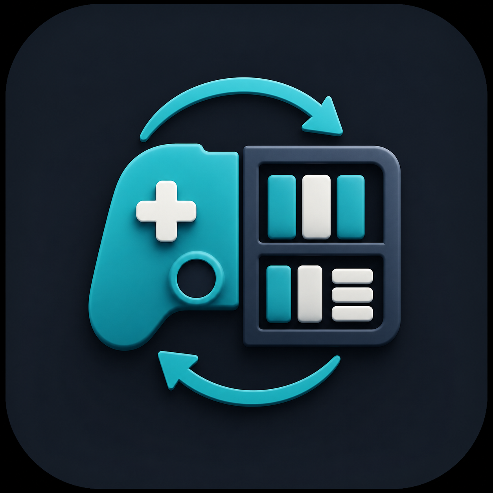

<p align="center">
  
</p>

# SteamShelf

Steam to Notion Game Library Sync

这是一个单独放在项目根目录的 Python 实现，用来替代参考项目 `Steam-to-dataframe-to-Notion` 中的 R 流程：

1. 从 Steam API 获取拥有的游戏、游玩时长、最后游玩时间和成就。
2. 从 Steam XML 游戏库补充 API 可能漏掉的网页来源游戏。
3. 用 Steam 商店接口和商店页补充开发商、发行商、标签、内容类型、封面、简介等字段。
4. 组装成 `pandas.DataFrame`。
5. Upsert 到 Notion 数据库：已有记录更新，不存在则新建。
6. 通过 GitHub Actions 每天定时同步。

## 文件结构

```text
.
├── assets/icon.png
├── main.py
├── sync.py
├── requirements.txt
├── README.md
└── .github/workflows/steam-to-notion.yml
```

## Notion 数据库字段

默认使用中文字段预设：`NOTION_SCHEMA=cn`。

脚本运行时会自动创建缺失的同步字段；你也可以提前在 Notion 数据库中手动创建这些属性：

| 属性名 | 类型 |
| --- | --- |
| 游戏名称 | title |
| 游戏封面 | files |
| 游戏ID | number |
| 商店链接 | url |
| 游玩时间 | text |
| 总时长/h | number |
| 完成度 | number（建议在 Notion 里设为 percent；脚本写入 `0.25` 表示 25%） |
| 成就总数 | number |
| 已解锁成就 | number |
| 首个成就解锁于 | date |
| 最后游玩日期 | date |
| 游玩状态 | status（建议预先添加：未开始、游玩中、暂搁置、已弃坑、已通关、全成就） |
| 开发商 | text |
| 发行商 | text |
| 发售日期 | date |
| 商店标签 | multi-select |
| 内容类型 | select |
| 数据源 | select（固定写入 `Steam`，方便以后混合管理其它平台） |
| 抓取来源 | select（`API` / `网页` / `两者都有`，用于判断字段可信度） |
| 所属账户 | select |
| 游戏简介 | text |
| 评分 | number（手工填写，建议 1-5） |
| 已上传 | checkbox |

`游戏简介` 会优先从 Steam 简体中文商店页抓取；如果页面没有简介或抓取失败，才退回 Steam API 返回的简介。

脚本会自动创建 `评分` 字段，但不会写入或覆盖评分值。你的 `评价` 建议写在页面正文里；脚本只更新页面属性、封面和图标，不会改页面正文。其它自定义字段，例如 `个人状态`、`备注`，也不会被覆盖。`游戏名称` 使用数据库现有的 title 属性；`游戏ID` 会自动创建，并在第一次匹配到旧页面时补上。

我建议至少保留 `数据源`、`游戏ID`、`商店链接`、`内容类型` 和 `所属账户`。其中 `数据源 + 游戏ID` 是跨平台管理时最稳的识别方式；Steam 以外的游戏可以把 `数据源` 写成 Epic、GOG、NS、PS 等，再用对应平台 ID 或手工编号管理。

`游玩状态` 是脚本根据成就、游玩时长和最后游玩日期做的自动粗判。没有成就系统的游戏不会再自动判成 `已通关`，只会按最近游玩时间归到 `游玩中`、`暂搁置`、`已弃坑` 或 `未开始`。有游玩时长但尚未解锁成就的游戏，也会按最后游玩日期归类，不会标成 `未开始`。

如果要兼容 `notion_steam_game_list` 的英文字段，设置：

```bash
NOTION_SCHEMA=legacy
```

## GitHub Secrets

必填：

| Secret | 说明 |
| --- | --- |
| `STEAM_API_KEY` | Steam Web API Key |
| `STEAM_USER_ID` | 17 位 SteamID64、Steam 自定义短链接名，或 Steam 个人主页 URL |
| `NOTION_API_KEY` | Notion Integration Token |
| `NOTION_DATABASE_ID` | Notion 数据库 ID |

可选：

| Secret / Variable | 默认值 | 说明 |
| --- | --- | --- |
| `STEAM_PROFILE_ID` | `STEAM_USER_ID` | XML 游戏库使用的 profile id，一般不用单独填 |
| `STEAM_ACCOUNT_NAME` | `STEAM_PROFILE_ID` | 写入 `所属账户` 的名字 |
| `STEAM_ACCOUNTS` | 空 | 多账号 JSON 数组，见下方示例 |
| `INCLUDE_PLAYED_FREE_GAMES` | `true` | 是否包含玩过的免费游戏 |
| `ENABLE_ITEM_UPDATE` | `true` | 已存在的 Notion 页面是否更新 |
| `ENABLE_FILTER` | `false` | 是否过滤短时长且无成就的记录 |
| `FETCH_WEB_LIBRARY` | `false` | 是否抓取 Steam XML 游戏库补充网页来源游戏 |
| `FETCH_STORE_METADATA` | `true` | 是否抓取商店开发商、发行商、标签、简介、内容类型等 |
| `SYNC_MAIN_GAMES_ONLY` | `true` | 是否只同步游戏本体，跳过 DLC、试玩版、原声音轨 |
| `SKIP_PLAYTIME_WEB` | `true` | 网页来源记录不更新游玩时间类字段 |
| `USE_ACCOUNT_FIELD` | 多账号时为 `true` | 用 `游戏ID + 所属账户` 作为匹配 key |
| `TOP_TAGS` | `5` | 抓取前几个商店标签 |
| `VERIFY_COVER_URLS` | `false` | 是否额外 HEAD 检查封面 URL 是否可访问 |
| `STORE_FAILURE_LIMIT` | `3` | Steam 商店接口连续失败几次后，本次运行跳过后续商店元数据 |
| `HTTP_TIMEOUT` | `15` | 单次 HTTP 请求超时秒数 |
| `HTTP_RETRIES` | `2` | 单个请求最大尝试次数 |
| repository variable `NOTION_SCHEMA` | `cn` | `cn` 或 `legacy` |

多账号示例：

```json
[
  {"steam_id": "7656119xxxxxxxxxx", "account": "主号"},
  {"steam_id": "my_custom_id", "account": "小号"}
]
```

## 本地运行

```bash
python -m venv .venv
source .venv/bin/activate
pip install -r requirements.txt
```

在项目根目录创建 `.env`：

```bash
STEAM_API_KEY=你的 Steam API Key
STEAM_USER_ID=你的 SteamID64 或自定义短链接名
NOTION_API_KEY=secret_xxx
NOTION_DATABASE_ID=你的 Notion database id
NOTION_SCHEMA=cn

# 国内网络本地测试建议先这样跑通；GitHub Actions 上可以删掉或改回 true
FETCH_WEB_LIBRARY=false
FETCH_STORE_METADATA=false
```

运行：

```bash
python main.py --debug
```

如果你本地有代理并想抓完整商店字段，可以在 `.env` 里设置：

```bash
FETCH_STORE_METADATA=true
HTTPS_PROXY=http://127.0.0.1:7890
HTTP_PROXY=http://127.0.0.1:7890
```

只抓数据、不写 Notion：

```bash
python main.py --dry-run --limit 10 --export-csv steam_games.csv
```

导出 Excel：

```bash
python main.py --dry-run --export-xlsx "Steam Data.xlsx"
```

## GitHub Actions

工作流文件位于：

```text
.github/workflows/steam-to-notion.yml
```

默认每天 `12:00 UTC` 自动运行，也可以在 GitHub 的 Actions 页面手动点 `Run workflow`。

## 参考教程
https://steamcommunity.com/sharedfiles/filedetails/?id=3473185375
https://steamcommunity.com/sharedfiles/filedetails/?id=3513470854
